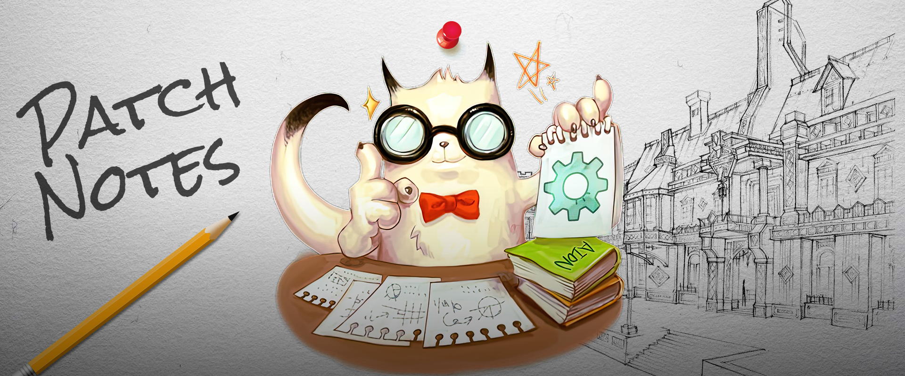

# Aion Patch Notes
This repository contains all major patch notes for NA and EU:
- The date in the folder name denotes the day the update went live. Dates in patch notes themselves, if present, refer to the day those got published.
- Up until version 2.7 NA patch notes also apply to EU (Gameforge became the European publisher partway through version 2.7 with the launch of "AION Free-to-Play" on February 28, 2012).